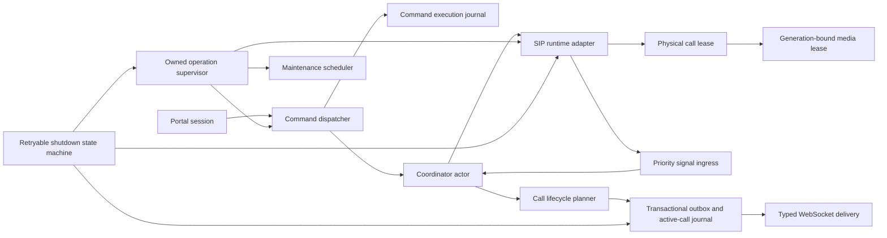

# SIP Windows Agent post-hardening remediation plan

วันที่จัดทำ: 11/10/2026  
Repository scope: `sip-windows-agent` เท่านั้น  
Implementation base: `0188fe9` (`fix: return active call instead of null when resolving missing dialogue`)  
สถานะ: **Source remediation implemented 11/10/2026; Windows/PBX/release gates pending**  
ผล implementation: [`2026-10-11-sip-agent-post-hardening-remediation-result.md`](plan-results/2026-10-11-sip-agent-post-hardening-remediation-result.md)

## บทสรุปและ release decision

การตรวจ source รอบหลัง comprehensive hardening ยืนยันว่า build และ portable core tests ผ่าน แต่ยังมี
failure interleaving ที่ automated suite ปัจจุบันไม่ครอบคลุม โดยเฉพาะ inbound answer timeout,
stale media cleanup, command cancellation, SIP signal overflow, terminal persistence เมื่อ outbox เต็ม
และ partial shutdown. จุดเหล่านี้กระทบ call ownership, durability, idempotency และ bounded shutdown
โดยตรง จึงยังห้ามประกาศ production ready หรือปิด Definition of Done.

แผนนี้เป็น remediation authority รอบถัดไปและครอบคลุม source changes, regression tests,
Windows/PBX fault matrix, observability, rollout และเอกสารผลลัพธ์ในรอบเดียว. การ implement ต้องไม่ขยายไปยัง
`web-app`, `web-api` หรือ repository อื่น เว้นแต่พบว่า protocol contract จำเป็นต้องเปลี่ยนและได้รับการอนุมัติใหม่.

เป้าหมายหลักมีดังนี้:

- timeout/cancellation ระหว่างรับสายต้องไม่สร้าง ghost call หรือ SIP leg ที่ไม่มี owner
- cleanup ของ call generation เก่าต้องไม่แตะ media ของ call generation ใหม่
- command ที่ side effect ทำต่อหลัง client disconnect ต้อง finalize journal ได้ใน process เดิม
- outbox reserve ต้องรับประกัน terminal lifecycle batch สำหรับ active call หนึ่งสาย
- signal overload ต้องไม่ทำให้ logical state และ physical SIP stateแยกจากกัน
- shutdown ต้อง retry/continue cleanup ได้และจบภายใน budget ที่วัดได้
- post-commit health/maintenance failure ต้องไม่เปลี่ยนผลสำเร็จของ committed business transition
- maintenance, WebSocket delivery และ resource ownership ต้องมี cancellation, drain และ typed result ชัดเจน

## หลักฐาน baseline

ผลตรวจบน macOS arm64 ด้วย Windows cross-targeting:

| Gate | Baseline result |
| --- | --- |
| Locked restore | PASS เมื่อใช้ `-p:EnableWindowsTargeting=true` |
| Solution build | PASS, 0 warnings, 0 errors |
| Portable core tests | PASS, 92/92 |
| Windows Host test assembly | Compile PASS; execution ต้องใช้ Windows Desktop runtime |
| Git working tree ก่อนจัดทำแผน | Clean |
| Dependency vulnerability query | Inconclusive; command ไม่คืนผลภายในเวลาตรวจและถูกยกเลิก |

ผลข้างต้นยืนยัน compile/unit baseline เท่านั้น ไม่ได้หักล้าง race, timeout, device, PBX หรือ shutdown faults
ที่ระบุในแผนนี้.

## ข้อจำกัดและ invariants ที่ต้องรักษา

1. คง Protocol V1, message/event names, exact ACK ordering และ one-Portal-owner contract.
2. คง SQLite schema v4 ใน mandatory remediation; ห้ามเพิ่ม migration หากแก้ด้วย source policy ได้.
3. Coordinator ยังคงเป็น single mutable owner ของ Agent, registration และ logical call state.
4. Runtime เป็น owner ของ physical SIP leg และ media resources; ownership ต้องผูกกับ call generation.
5. Durable event ต้อง commit ก่อน publish และ publisher failureห้ามย้อนผล durable commit.
6. Command ID เดิมกับ canonical payload เดิมต้องไม่ execute side effect ซ้ำ.
7. Terminal call transition ต้องมี `call.state_changed` และ `call.ended` ครบหนึ่งชุดเท่านั้น.
8. ห้าม auto-retry `dial`, `answer`, `reject`, `hangup` หรือ `DTMF` เมื่อไม่ทราบผล side effect.
9. ทุก background task ต้องมี owner, cancellation policy, fault observation และ bounded drain.
10. ห้าม catch process-fatal exceptions เพื่อแปลงเป็น business success/failure แล้วทำงานต่อ.
11. Logs, metrics, diagnostics และ evidence ห้ามมี credential, phone number, raw Origin, SDP,
    SIP header, DTMF, call ID หรือ command ID.
12. Mandatory remediation ต้องรักษา binary rollback กับ artifact/schema ปัจจุบัน.

## Finding register

P1 เป็น release blocker. P2 เป็น production-complete gate และต้องปิดใน implementation program นี้
เว้นแต่มี owner risk acceptance พร้อม expiry และ compensating control.

| ID | Priority | Finding | Production impact | Required disposition |
| --- | --- | --- | --- | --- |
| SIP-POST-001 | P1 | `SIPUserAgent.Answer` ยังทำต่อหลัง `WaitAsync` timeout/cancellation | ghost inbound call, call รับแล้วค้าง, ไม่มี handle สำหรับ hangup | แก้ก่อน release |
| SIP-POST-002 | P1 | stale cleanup ตรวจ ownership ก่อนรอ media gate แต่ไม่ตรวจซ้ำหลังได้ gate | callback ของสายเก่าปิด media ของสายใหม่ | แก้ก่อน release |
| SIP-POST-003 | P1 | request cancellation ทำ final command journal save ด้วย token ที่ถูก cancel | command ค้าง `executing`, retryได้ `command_outcome_unknown` จน restart | แก้ก่อน release |
| SIP-POST-004 | P1 | outbox capacity check ไม่คิด projected batch และไม่มี terminal reserveแบบบังคับ | active call เขียน terminalไม่ได้หรือเขียนเกิน hard maximum | แก้ก่อน release |
| SIP-POST-005 | P1 | signal overflowจบ logical callโดยไม่ terminate physical SIP leg | coordinator/runtime split-brain และสายจริงค้าง | แก้ก่อน release |
| SIP-POST-006 | P1 | shutdownตั้ง `stopping` ก่อน cleanupและ retryครั้งถัดไปเป็น no-op | partial shutdownไม่สามารถ resume; unregister/checkpoint/terminalอาจหาย | แก้ก่อน release |
| SIP-POST-007 | P1 | media cleanupรอ semaphoreโดยไม่มี cancellation/budget | shutdownเกิน 10 วินาทีหรือค้างถาวร | แก้ก่อน release |
| SIP-POST-008 | P1 | terminal commitสำเร็จแล้วแต่ health read failureเปลี่ยน commandเป็น failureและข้าม cleanup | clientเห็นผลผิด, credential lease/registration cleanupไม่ครบ | แก้ก่อน release |
| SIP-POST-009 | P2 | command pruneเรียก async methodตรงจาก request, ไม่มี owner cancellation/drain | latency spike, taskรอด shutdown, claimในเอกสารคลาดเคลื่อน | ปิดก่อน production complete |
| SIP-POST-010 | P2 | WebSocket control sendเมื่อไม่มี sessionคืน success และ cancellationทุกชนิดถูก mapเป็น timeout | silent result loss และ failure telemetryผิด domain | ปิดก่อน production complete |
| SIP-POST-011 | P2 | broad `catch` หลายจุดกลืน fatal exception; externally-created storeไม่มี explicit lifetime owner | processเดินต่อในสภาพไม่ปลอดภัยและ resourceรั่วเมื่อ runtimeวนใหม่ | ปิดก่อน production complete |

### Source evidence

| Finding | Evidence |
| --- | --- |
| SIP-POST-001 | [`SipRuntime.AnswerAsync`](../Host/SipRuntime.cs) ใช้ `Answer(...).WaitAsync(...)`; timeout pathล้าง ownershipแต่ไม่ terminate underlying answer |
| SIP-POST-002 | [`CleanupMediaForCallAsync`](../Host/SipRuntime.cs) เรียก `EnsureActiveCall` ก่อนเข้า [`CleanupMediaAsync`](../Host/SipRuntime.cs) ซึ่งใช้ global media fields |
| SIP-POST-003 | [`V1CommandDispatcher.DispatchAsync`](../Host/V1CommandDispatcher.cs) บันทึก `executing`, catch cancellationแบบ generic และ final saveด้วย request tokenเดิม |
| SIP-POST-004 | [`AppendCallTransitionInternalAsync`](../src/DebtFlow.SipAgent.Persistence/SqliteAgentEventStore.cs) ตรวจ healthก่อน loopโดยไม่คิด `drafts.Count` |
| SIP-POST-005 | [`SipRuntime.Emit`](../Host/SipRuntime.cs) drop signalแล้วส่ง `RuntimeFailed`; [`ApplySipSignalCoreAsync`](../src/DebtFlow.SipAgent.Application/AgentCoordinator.cs) ไม่ terminate runtime call |
| SIP-POST-006 | [`ShutdownCoreAsync`](../src/DebtFlow.SipAgent.Application/AgentCoordinator.cs) returnทันทีเมื่อ stateเป็น `stopping` |
| SIP-POST-007 | [`CleanupMediaAsync`](../Host/SipRuntime.cs) ใช้ `_mediaGate.WaitAsync()` โดยไม่มี token |
| SIP-POST-008 | [`EndCallCoreAsync`](../src/DebtFlow.SipAgent.Application/AgentCoordinator.cs) ทำ health refreshและregistration cleanupหลัง durable commitใน exception boundaryเดียวกัน |
| SIP-POST-009 | [`ScheduleCommandPruneIfDue`](../Host/V1CommandDispatcher.cs) เรียก `PruneCommandsAsync()` โดยตรงและใช้ `CancellationToken.None` |
| SIP-POST-010 | [`WebSocketEventPublisher.SendAsync`](../Host/WebSocketEventPublisher.cs) คืน completedเมื่อ `_session == null`; [`LocalWebSocketServer`](../Host/LocalWebSocketServer.cs) map `OperationCanceledException`เป็น timeoutทั้งหมด |
| SIP-POST-011 | bare catchesใน coordinator/runtime/dispatcher/publisher และ instance registrationของ event storeใน [`Program.cs`](../Program.cs) |

## Target architecture



Design patterns ที่ใช้:

- generation-bound resource lease สำหรับ physical SIP call และ media
- actor/state-machine สำหรับ logical state และ retryable shutdown phases
- transactional outbox พร้อม explicit terminal capacity reservation
- command execution fence แยก request lifetime จาก side-effect lifetime
- typed fault taxonomy แยก store, transport, timeout, overload, shutdown และ fatal process failure
- supervised maintenance service แยกจาก request path
- bulkhead/priority ingress สำหรับ critical SIP terminal signals

## Workstream A — Inbound answer ownership และ late completion fence

### Required implementation

1. แยก SIPSorcery interactionหลัง `ISipRuntime` ด้วย adapter ที่ test delayed answer completion ได้โดยไม่ใช้ PBXจริง.
2. สร้าง inbound answer operationที่เก็บ call handle/generation, server user agent, media lease,
   underlying answer task และ terminal fence.
3. `TakePendingIncoming` ต้องไม่ทำให้ runtimeสูญเสีย referenceที่จำเป็นต่อ reject/terminate ก่อน answer outcomeชัดเจน.
4. เมื่อ timeoutหรือ application cancellation:
   - mark generationว่า closingก่อน
   - terminate pending/established SIP legตาม stateจริง (`Reject`, `Cancel` หรือ `Hangup`)
   - observe underlying answer taskด้วย bounded grace
   - late successหลัง fenceต้องถูก hangupทันทีและห้าม emit `CallConnected`
5. Cleanup mediaและ clear call ownershipหลัง termination fenceเท่านั้น.
6. Outcome mappingต้อง deterministic: timeout=`answer_timeout`, lifetime shutdown=`agent_shutdown`,
   runtime fault=`sip_runtime_error`; ห้ามเปลี่ยน shutdownเป็น business timeout.

### Regression tests

- answerสำเร็จก่อน timeout → connectedครั้งเดียว
- answer timeoutแล้ว underlying taskสำเร็จภายหลัง → callถูก terminate, ไม่มี connected/ghost call
- cancellationชน answer completion → terminalครั้งเดียวและไม่ leak media
- remote cancelระหว่าง answer → missed/cancel outcomeถูกต้องและ late answerไม่ revive call
- shutdownระหว่าง answer → จบภายใน budgetและไม่มี unobserved task fault

## Workstream B — Generation-bound media lifecycle

### Required implementation

1. แทน global media fieldsที่ไม่มี identityด้วย `MediaSessionLease` ซึ่งเก็บ call generation,
   session, endpoint และ fallback source.
2. การ create, replace, close และ dispose leaseต้องเกิดใต้ `_mediaGate` เดียวกัน.
3. `CleanupMediaForCallAsync` ต้อง acquire gateก่อน แล้วตรวจ generationซ้ำภายใน critical section.
4. Cleanupของ stale generationคืนผล `NoOpStale`; ห้ามแตะ active/new lease.
5. terminal callbackซ้ำต้อง coalesceด้วย per-generation cleanup taskหรือ idempotent close state.
6. volume apply/device callbackต้องจับ lease generationและ ignoreงานของ callเก่า.

### Regression tests

- cleanup A/B ของสายเก่าชนการสร้างสายใหม่ → mediaใหม่ไม่ถูกปิด
- duplicate `OnCallHungup`/`ClientCallFailed` → close/disposeครั้งเดียว
- old volume/background callbackหลังสายใหม่เริ่ม → ไม่แก้ mediaใหม่
- cleanup exceptionหนึ่งขั้น → remaining resourcesยัง disposeและ supervisorเห็น fault

## Workstream C — Command execution fence และ journal finalization

### Required implementation

1. แยก tokenสามชนิดให้ชัดเจน:
   - session/request token สำหรับรับข้อความและส่ง response
   - command execution token ที่ ownerโดย Agent พร้อม per-command timeout
   - bounded finalization tokenสำหรับเขียน final journalแม้ client disconnect
2. หลัง `executing` commitแล้ว ห้ามใช้ request tokenควบคุม side effectหรือ final journal save.
3. Client disconnectต้องหยุดรอ/ส่ง responseได้ แต่ owned execution continuationต้อง finalize
   `completed`, `failed` หรือ `abandoned` ภายใน processเดิม.
4. Command execution taskต้องอยู่ใน supervisorที่ shutdownสามารถ cancelและ drainได้.
5. Duplicate requestขณะ executionยังทำงานต้องคืนผล provisionalเดิมโดยไม่ executeซ้ำ; หลัง continuationจบต้องคืน final result.
6. Shutdownก่อน side effectเริ่มให้ mark `abandoned`; shutdownหลัง side effect commitแต่ก่อน final saveให้บันทึก
   `command_outcome_unknown` แบบ explicitโดยใช้ cleanup token.
7. ไม่เพิ่ม auto-retryของโทรศัพท์หรือ DTMF.

### Regression tests

- disconnectหลัง `executing` แต่ก่อน dequeue → abandoned/finalized, ไม่ค้าง executing
- disconnectขณะ side effectทำงาน → side effectครั้งเดียวและ final resultถูกเก็บ
- duplicate commandระหว่าง execution → ไม่ executeซ้ำ
- final store failureหลัง side effect → outcome unknownและ Agent degradedตาม store domain
- host shutdownพร้อม executing commandsหลายรายการ → bounded drainและไม่มี unobserved fault

## Workstream D — Terminal outbox capacity reservation

### Required implementation

1. Capacity APIต้องรับ projected event count/serialized bytesและ transition class (`regular`, `active-call`, `terminal`).
2. กัน reserveขั้นต่ำสำหรับ terminal batchของ active callหนึ่งสาย:
   - regular/non-terminal appendห้ามใช้สอง event slotsสุดท้าย
   - terminal batchใช้ reserveได้แต่ projected countห้ามเกิน hard maximum
   - new call startต้องเหลือ terminal reserveหลัง start batch commit
3. สำหรับ byte ceilingให้กำหนด bounded terminal byte reserveจาก maximum encoded terminal payload
   พร้อม safety margin; transactionต้อง rollbackหาก actual sizeหลัง insertเกิน permitted class limit.
4. Capacity decision, batch insertsและ active-call journal mutationต้องอยู่ใน SQLite transaction/serialized gateเดียวกัน.
5. Optional/high-volume call events เช่น DTMF ต้องไม่กิน terminal reserve; เมื่อ reserveเริ่มใช้ให้ emit
   observable capacity stateและ block non-terminal durable appendตาม deterministic policy.
6. Health snapshotต้องรายงาน regular remaining capacityและ terminal reserve availability.

### Regression tests

- pending=`max-2` → regular appendถูก blockแต่ terminalสอง eventsสำเร็จ
- pending=`max-1` และ `max` → invariantไม่ยอมให้ batchเกิน maximum
- start batchต้องถูก blockหาก commitแล้วไม่เหลือ terminal reserve
- byte ceiling faultระหว่าง second terminal insert → rollbackทั้ง batchและ journal
- ACKคืน capacityแล้ว stateกลับ healthyโดยไม่ restart

## Workstream E — SIP signal overload และ controlled runtime failure

### Required implementation

1. แบ่ง signal ingressอย่างน้อยเป็น critical laneและcoalescible lane:
   - critical: incoming ownership, connected, failed, remote-ended, cancelled, runtime-failed
   - coalescible/drop-safe: repeated registration/audio inventory/media telemetryที่มี latest-state policy
2. Critical terminal signalห้ามถูก silently drop. หาก critical laneรับไม่ได้ต้องเข้าสู่ controlled runtime stop.
3. Runtime overload policyต้อง terminate physical call/mediaก่อนหรือพร้อมกับ logical terminal transition.
4. `RuntimeFailed` ใน coordinatorต้องเรียก explicit runtime quiesce/terminate operationที่ idempotent
   และ generation-aware ไม่ใช่ล้าง logical handleอย่างเดียว.
5. Overflow latchต้องรายงาน dropped/coalesced count, lane depth, active call generation presenceแบบไม่เปิด identifier.
6. หลัง overload Agentต้อง block callใหม่, stop registrationเมื่อปลอดภัย และยัง shutdownได้.

### Regression tests

- saturate coalescible lane → critical terminalยังผ่านและไม่มี callค้าง
- force critical overflow → physical leg terminateและ logical terminalหนึ่งครั้ง
- overflowขณะ inbound pending/answering/outbound dialing/connected
- stale signalหลัง controlled stopไม่เปลี่ยน callรุ่นใหม่

## Workstream F — Retryable bounded shutdown

### Required implementation

1. แทน boolean/string guardด้วย shutdown state machine: `NotStarted`, `InProgress`, `Completed`, `Incomplete`.
2. ทุก callerใช้ shared shutdown task; cancellationของ callerห้ามยกเลิก shared cleanupโดยอัตโนมัติ.
3. Shutdown phasesต้อง checkpointความสำเร็จเพื่อ retryเฉพาะ phaseที่ยังไม่เสร็จ:
   1. stop intake/new commands
   2. cancel owned command/registration/background operations
   3. terminate physical SIP callและ media
   4. persist logical terminalเท่าที่ storeพร้อม
   5. unregister/clear credentials
   6. checkpoint store
   7. drain supervisors/publisher/logger
   8. dispose runtime/resources
4. แต่ละ external operationต้องมี timeoutและfallback policy; media gate waitต้องรับ cancellation token.
5. timeoutหนึ่ง phaseต้องไม่ข้าม remaining independent cleanup phases.
6. `DisposeAsync` ต้อง await/retry incomplete shutdownภายใน process budgetและ aggregateเฉพาะ non-fatal diagnostics.

### Budget

| Phase | Maximum target |
| --- | ---: |
| Stop intake/cancel operations | 1 s |
| SIP hangup/reject and media close | 3 s |
| Unregister | 2 s |
| Terminal persistence/checkpoint | 2 s |
| Drain/dispose remainder | 2 s |
| Total | ≤10 s |

### Regression tests

- cancellation/faultในทุก phaseแล้วเรียก shutdownซ้ำ → cleanup resumeและ completed
- media gateถูก hold → timeout/fallbackทำงานและ processไม่ค้าง
- shutdownพร้อม outbound dialing/inbound answering/connected call/audio test/registration retry
- repeated shutdownและdisposeหลายครั้ง → idempotent ไม่มี double terminal

## Workstream G — Post-commit side-effect isolation

### Required implementation

1. แยก `EndCallCoreAsync` เป็นสามช่วง:
   - atomic terminal commit
   - in-memory terminal apply
   - best-effort post-commit actions
2. เมื่อสองช่วงแรกสำเร็จ command outcomeต้องเป็น success; health refresh failureห้ามย้อนผล.
3. Credential/registration cleanupต้องอยู่ใน `finally`/owned post-commit operationที่รันแม้ health readล้ม.
4. Post-commit store health failureต้อง mark degradedด้วย typed store faultและ schedule health retry.
5. Post-commit operationต้อง idempotent, supervised และ observable.

### Regression tests

- terminal commitสำเร็จแต่ health readล้ม → command success, call ended, cleanupยังรัน
- registration stopล้มหลัง terminal → terminalไม่เปลี่ยน, Agent degradedและ retry policyชัดเจน
- publish/health/cleanupล้มพร้อมกัน → ไม่มี double terminalและ fault domainsถูกต้อง

## Workstream H — Maintenance scheduler และ lifetime ownership

### Required implementation

1. ย้าย command pruneไป hosted/owned maintenance schedulerหรือ dedicated background queueจริง.
2. Schedulerต้องเริ่มหลัง startup pruneและตั้ง first due timeเพื่อไม่ pruneซ้ำบน commandแรก.
3. ใช้ application lifetime cancellation, single-flight guard, failure backoffและbounded shutdown drain.
4. SQLite workห้ามเริ่ม synchronouslyจาก dispatch call stack.
5. เพิ่ม health fields: running, last success age, last failure code, durationและnext dueโดยไม่ใส่ identifier.
6. Event storeที่สร้างนอก DIต้องมี explicit `await using` owner หรือ factory serviceที่ containerเป็นผู้สร้าง/disposing.

### Regression tests

- first command latencyไม่รวม pruneแม้ fake prune block synchronously
- concurrent commands schedule pruneครั้งเดียว
- shutdownขณะ prune → cancel/drainตาม budget
- runtime maintenance loopหลายรอบ → ไม่มี SQLite handle/task leak

## Workstream I — Typed WebSocket delivery และ cancellation taxonomy

### Required implementation

1. แยก API semantics:
   - durable offline publish = committed/replay-pending
   - realtime offline publish = droppedพร้อม metric
   - control/result sendเมื่อไม่มี healthy session = explicit `NotConnected` failure
2. ห้าม `Task.CompletedTask` สำหรับ control messageที่ไม่ได้ enqueue.
3. แยก timeout token, request-aborted token, application-shutdown tokenและwriter-fault completion
   เพื่อให้ close reason/metricถูกต้อง.
4. Diagnosticsต้องรวม deferred/activation depth/high-waterและdelivery outcome.
5. Activation bufferต้องไม่ให้ realtime backlogหน่วง durable live eventเกิน fairness budget.
6. Session detach/disposeต้อง complete pending delivery barriersด้วย typed disconnect result ไม่ใช่ ambiguous cancellation.

### Regression tests

- control sendไม่มี session → explicit failure
- client abort/application shutdown/receive timeout/writer fault → close classificationต่างกัน
- replay disconnectก่อน page, กลาง pageและหลัง final send → storeไม่ degradedและ replayใหม่ครบ
- deferred realtime saturation → controlและdurable progressภายใน bound

## Workstream J — Fatal exception policy และ resource safety

### Required implementation

1. เพิ่ม shared helper/policyสำหรับ catchable non-fatal operational exceptions; ห้าม bare catchใน pathที่ทำงานต่อ.
2. `OutOfMemoryException`, `AccessViolationException` และ fatal runtime stateต้อง propagateถึง process boundary.
3. Callback boundaryที่จำเป็นต้องไม่ throwกลับ third-party libraryต้อง request controlled application stop
   หลัง best-effort minimal logging แทนการเดินต่อแบบ degraded.
4. Logger/tray may-fail boundaryต้องยัง exclude fatal exceptions.
5. ตรวจ disposable ownershipทั้งหมด: event store, publisher session, runtime, media, logger, certificate,
   debounce token sources และ maintenance supervisors.
6. เพิ่ม leak counters/evidenceสำหรับ handles, threads, pending tasksและSQLite connectionsใน soak.

## Implementation sequencing

ลำดับนี้เป็น mandatory เพื่อไม่ให้ refactorซ่อน regression:

### Phase 0 — Characterization และ failing regressions

- เพิ่ม deterministic fakesสำหรับ delayed answer, media gate interleaving, request cancellation,
  projected capacity, signal overloadและshutdown phase faults
- testsต้อง failบน baselineด้วยสาเหตุที่คาดก่อนแก้ source
- บันทึก baseline duration/handle/task counts

### Phase 1 — Call/runtime correctness

- Workstream A inbound answer fence
- Workstream B generation-bound media lease
- Workstream E physical/logical overload recovery
- รัน inbound/outbound lifecycle matrixหลังแต่ละ change

### Phase 2 — Durability และ idempotency

- Workstream C command execution fence
- Workstream D terminal reserve
- Workstream G post-commit isolation
- รัน crash/fault injectionและrestart recovery matrix

### Phase 3 — Shutdown และ owned background work

- Workstream F retryable shutdown
- Workstream H maintenance scheduler/resource ownership
- รัน shutdown matrixและ soakก่อนเปลี่ยน WebSocket behavior

### Phase 4 — Transport/error taxonomy

- Workstream I typed WebSocket delivery
- Workstream J fatal exception/resource policy
- รัน replay/disconnect/QoS/privacy tests

### Phase 5 — Windows/PBX evidence และ documentation closure

- รัน automated Windows verifierจาก clean worktree
- PBX/audio/device/fault/performance/soak matrix
- update plan result, production readiness review, README และ DoDด้วย evidenceจริง

## Expected file change map

| File/area | Planned responsibility |
| --- | --- |
| `Host/SipRuntime.cs` | answer termination fence, generation-bound physical call/media ownership, cancellable cleanup |
| new runtime adapter/lease files under `Host/` | SIPSorcery abstraction, call lease, media leaseและtyped termination result |
| `src/.../AgentCoordinator.cs` | runtime-failure quiesce, post-commit isolation, retryable shutdown orchestration |
| `src/.../AgentContracts.cs` | typed operation/fault/health contractsและprojected capacity intent |
| `src/.../BackgroundTaskSupervisor.cs` | cancellation/drain supportหรือ replacementด้วย owned operation registry |
| `src/.../SqliteAgentEventStore.cs` | projected capacity, terminal reserveและatomic enforcement |
| `Host/V1CommandDispatcher.cs` | request/execution/finalization token separationและowned command continuation |
| new maintenance hosted service | command prune scheduling, healthและshutdown ownership |
| `Host/WebSocketEventPublisher.cs` | typed delivery result, activation health/fairnessและdisconnect completion |
| `Host/LocalWebSocketServer.cs` | cancellation/close taxonomyและcontrol delivery failure handling |
| `Program.cs` | application lifetime wiringและexplicit disposable ownership |
| Core tests | lifecycle, capacity, command cancellation, shutdown state machine |
| Host tests | delayed answer, media race, WebSocket, maintenanceและresource lifecycle |
| manual verification docs | PBX/device/fault/soak evidenceและabort thresholds |

## Automated verification matrix

### Portable gates

```bash
dotnet restore softphone-native-client.sln --locked-mode -p:EnableWindowsTargeting=true
dotnet build softphone-native-client.sln -c Release --no-restore -p:EnableWindowsTargeting=true
dotnet test tests/DebtFlow.SipAgent.Core.Tests/DebtFlow.SipAgent.Core.Tests.csproj -c Release --no-build
git diff --check
```

ต้องเพิ่ม test categories/filtersอย่างน้อย:

- `InboundAnswerFence`
- `MediaGenerationIsolation`
- `CommandCancellationFinalization`
- `TerminalCapacityReserve`
- `SignalOverflowRecovery`
- `RetryableShutdown`
- `PostCommitIsolation`
- `MaintenanceLifecycle`
- `WebSocketDeliveryTaxonomy`
- `FatalExceptionPolicy`

### Windows gates

```powershell
./scripts/verify-p2-windows.ps1
./scripts/verify-p5-release.ps1
```

Windows evidenceต้องมี:

- full Host/Core TRXผ่านจาก clean checkout
- dependency vulnerability scanสำเร็จและ 0 advisories; ห้ามใช้ผล inconclusive
- self-contained win-x64 artifact launch/exit/relaunch
- SQLite preflight, restart recoveryและrollback rehearsal
- handle/thread/task/working-set trendก่อนและหลัง soak

## PBX, audio และ chaos matrix

| Scenario | Required result |
| --- | --- |
| inbound answerปกติ/ช้า/timeout/remote-cancel | ไม่มี ghost call; terminalหนึ่งครั้ง |
| outbound trying/ringing/fail/remote hangup | generation correlationถูกต้อง |
| duplicate terminal callbacks | media disposeและdurable terminalหนึ่งครั้ง |
| new callทันทีหลังสายเก่าจบ | stale cleanupไม่แตะสายใหม่ |
| Portal disconnectระหว่าง command | journal finalizeใน processเดิม; side effectไม่ซ้ำ |
| outboxที่ `max-2`, `max-1`, `max` | terminal reserveและhard ceilingถูกต้อง |
| signal realtime flood/critical overflow | critical terminalไม่หายหรือ controlled stopครบ |
| SQLite health failureหลัง terminal commit | terminal successไม่ถูกย้อน; Agent degradedถูก domain |
| shutdownทุก call state | ≤10 s; retry incomplete phaseได้ |
| WebSocket replay disconnectสามตำแหน่ง | storeไม่ degraded; reconnect replayครบ/ordered |
| speaker/mic removeระหว่าง answer/connected/cleanup | ไม่มี deadlock/cross-call cleanup |
| 2 ชั่วโมง/50 calls | ไม่มี unbounded handles, tasks, threads, memoryหรือDB growth |

## Observability requirements

Diagnostic snapshotและmetricsต้องเพิ่มโดยไม่เปิด identifiers:

- physical call lease stateและ generation-present boolean
- media lease state, cleanup in-flight count, stale cleanup countและlate-answer termination count
- command executions active/finalization failures/orphan executing count
- regular outbox capacity remainingและ terminal reserve availability
- critical/coalescible signal depth, high-water, dropped/coalescedและcontrolled-stop count
- shutdown phase, elapsed time, retries, incomplete phaseและbudget exceeded count
- maintenance last success/failure/duration/next due
- WebSocket control delivery failures, deferred/activation depthsและdisconnect reason
- disposable/resource countsที่ใช้เปรียบเทียบก่อน/หลัง soak

Metric tagsต้องเป็น low-cardinality constantsเท่านั้น.

## Compatibility, rollout และ rollback

### Compatibility

- Protocol V1 และ Portal payloadไม่เปลี่ยน
- SQLite schema v4ไม่เปลี่ยน
- event orderingและACK contractไม่เปลี่ยน
- Agent version/capability bumpทำเฉพาะเมื่อ release processกำหนด ไม่ทำเพื่อ source refactorอย่างเดียว

### Rollout prerequisites

1. P1 source DoDทั้งหมดผ่าน.
2. Windows/PBX/chaos matricesผ่านบน exact release commit.
3. Artifact checksum, SBOM, TRXและevidenceผูกกับ commitเดียวกัน.
4. Existing approved security exceptionsยังมี owner/expiry/compensating controls.
5. Binary rollback rehearsalยืนยันว่า schema/storageเปิดด้วย previous artifactได้.

### Immediate abort triggers

- ghost/unowned SIP callแม้หนึ่งครั้ง
- stale cleanupกระทบ call generationใหม่แม้หนึ่งครั้ง
- duplicate dial/answer/reject/hangup/DTMF side effect
- commandค้าง `executing`หลัง owned operationจบ
- double terminal, missing terminal pairหรือ ACK sequence gap
- physical/logical call stateไม่ตรงกันหลัง overload
- shutdownเกิน 10 วินาทีหรือ processค้าง
- terminal reserveหมดก่อน active callจบ
- durable/control messageหายแบบ silent
- PII/credentialปรากฏใน log, diagnostic, metricหรือevidence

เมื่อ abort ให้หยุดเปิดสายใหม่และ rollback binaryตาม runbook โดยห้ามลบ SQLite/WAL, clear outbox,
force ACK หรือ regenerate command fingerprint key.

## Definition of Done checklist

### Source correctness

- [x] SIP-POST-001 late inbound answerถูก fencedและ physical legถูก terminateใน source
- [x] SIP-POST-002 media cleanupตรวจ generationภายใน cleanup critical sectionและไม่กระทบ callใหม่
- [x] SIP-POST-003 client disconnectหลัง `executing` ไม่ทิ้ง commandค้างจาก request cancellation
- [x] SIP-POST-004 terminal reserveและprojected hard ceilingบังคับใต้ serialized transaction boundary
- [x] SIP-POST-005 signal overloadเข้า controlled stopที่ terminate physical legก่อน logical terminal
- [x] SIP-POST-006 shutdown incomplete call phase retryได้ในการเรียกครั้งถัดไป
- [x] SIP-POST-007 media/runtime cleanup waitsมี cancellationและ 3-second bound
- [x] SIP-POST-008 post-commit failureไม่ย้อน terminal successและยังทำ credential cleanup
- [x] SIP-POST-009 maintenanceออกจาก synchronous request stackและมี owned cancellation/drain
- [x] SIP-POST-010 offline control delivery fail explicitและ cancellation classificationแยก request abort/timeout
- [x] SIP-POST-011 fatal exception policyและ event-store disposable ownershipถูกแก้ใน source

### Automated evidence

- [ ] ทุก findingมี failing-before/passing-after deterministic regression
- [ ] Core และ Host testsผ่าน 100%; ไม่มี flaky retryใช้ซ่อน race
- [x] locked restore/buildผ่าน 0 warnings/errors
- [x] format/whitespace/diff gatesผ่าน
- [ ] vulnerability scanสำเร็จ 0 advisoriesและไม่มี incomplete project
- [ ] crash/restart/fault injectionไม่สร้าง duplicateหรือ partial lifecycle

### Windows/PBX evidence

- [ ] inbound/outbound/PBX UDP/TCP/auth/NAT matrixผ่าน
- [ ] delayed answer/remote cancel/device loss interleavingsผ่าน
- [ ] replay disconnect/QoS saturationผ่าน
- [ ] shutdownทุก scenario ≤10 วินาที
- [ ] 2-hour/50-call soakไม่มี unbounded resource trend
- [ ] privacy scanผ่าน

### Documentation/release

- [x] สร้าง implementation resultผูก implementation baseและสรุป deviationsจากแผน
- [x] update README, production readiness reviewและ manual checklist routing
- [ ] rollback rehearsalและabort thresholdsได้รับ owner sign-off
- [ ] ไม่มี checkboxถูกปิดจาก source inspectionอย่างเดียวเมื่อ gateต้องใช้ Windows/PBX evidence

## Completion rule

แผนนี้ยังไม่ถือว่า implementedจนกว่า source changes, deterministic regressions, Windows/PBX evidence
และ DoDทุกข้อที่ไม่มี approved exceptionจะผ่านบน exact release commit. Buildผ่านหรือ core tests 92/92
ไม่เพียงพอสำหรับปิด findingใดใน SIP-POST-001 ถึง SIP-POST-011.
